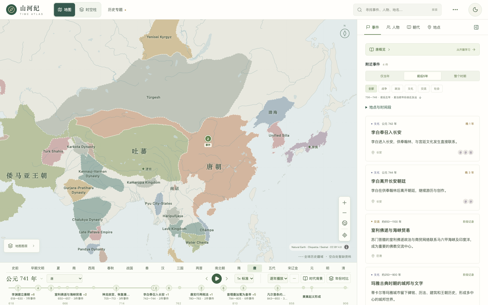

# 山河纪 · Time Atlas

**在地图上读历史，在时间中看山河。**

山河纪是一个开源历史网站。沿时间轴看疆域变化，点开地图上的事件读它的来龙去脉，或切换到时空柱，对照同一时期的中国与世界。

**[打开地图](https://history.zhaoguhong.com/)** · [浏览历史专题](https://history.zhaoguhong.com/topics/) · [功能与用法](#可以怎样探索) · [本地运行](#本地运行) · [数据与来源](#数据来源与边界)

[](https://history.zhaoguhong.com/#year=741&lng=101&lat=36&zoom=3.1)

_公元 741 年的地图与附近事件。点击图片可打开对应年份和视角。_

## 可以怎样探索

- **地图**可跳转年份、播放年代或对比两个年份的疆域。点击事件或政权，可以继续查阅人物、地点和出处。
- **时空柱**把中外事件放在同一条时间轴两侧。可按地区、类别和年代筛选，也可让画布按收录事件自动向后浏览。
- **历史专题**从一件器物、一封信或一条路线读起。可以跟着侨批看一笔跨海汇款，沿运河看漕粮进京，或从航海钟了解怎样确定海上经度。郑和下西洋、玄奘西行等专题章节可逐站查看路线。
- **人物年谱**可以跟随苏轼、康熙、诸葛亮等人的已核对活动记录，按年代逐站浏览。

可以按人物及别名、事件、地点和主题搜索。档案与专题都有独立分享网址，地图链接可保存当前视角。收藏与阅读进度保存在当前浏览器，首页可继续上次阅读。

## 地图与时空柱

### 地图：事件发生在哪里

在左下角的“地图图层”控制历史事件、城市与都城、政权图层。想限定事件所在区域时，在列表里选“只看当前地图范围”。移动地图后，可从“地点与时间段”重新选取范围。

地图与时空柱共享选中事件，各自记住时间筛选。查看 1912 年之后的事件时，画布使用 1912 年的疆域作位置参照，并标出事件年份和地图年份。

### 时空柱：同一时期发生了什么

在顶栏切换到“时空柱”。中外对照时，左边是中国之外的历史，右边是中国历史。右下角的“设置”可以切换中外对照、中国或世界，筛选地区及事件类别。

| 操作                   | 方法                                                                                |
| ---------------------- | ----------------------------------------------------------------------------------- |
| 移动年代               | 上下拖动或滚轮滚动                                                                  |
| 缩放时间范围           | 手机双指捏合；桌面 Ctrl / ⌘ 加滚轮，或点击 ＋ / −                                   |
| 跳转年份               | 点击画布中央年份，或展开设置 → 年份与时期                                           |
| 找到当前范围的全部事件 | 设置 → 当前范围事件，支持搜索、阅读与范围定位                                       |
| 自动向后浏览           | 设置 → 自动浏览与停留，可选每站停留 4、6 或 10 秒，拖动或打开事件即停止             |
| 更换外观               | 设置 → 外观与简介，可选琉璃时柱、素笺编年、山河长卷、经纬织带、留白、大事记、观测站 |

画布放不下的事件仍可在“当前范围事件”中查找。想看整个时期，可在“年份与时期”展开画布。想筛选事件并限定自动浏览，则设置起止年。画布获得键盘焦点后，可用方向键、加减键和 Home / End 操作。

### 手机阅读与显示

打开人物、事件、朝代、世界政权或地点的独立网址时，先显示正文，点“在地图中查看”再打开交互地图。手机竖屏在底部显示事件资料，横屏可同时查看左侧地图与右侧资料。

专题目录支持搜索、分类和三种展示方式。读文章时，可从“文章目录”跳到小节，放大插图，或按需展开文中的交互地图。点进“延伸阅读”的史事后，可以通过“专题导读与目录”回到原文。文中地图的操作只作用于当前插图，返回主地图时可接着原来的年份和视角浏览。

手机在“更多操作”中切换昼夜模式、进入专注模式或全屏，也可按浏览器提示添加到主屏幕。添加后仍需联网加载内容。

## 内容覆盖

时空柱与事件阅读范围约为**公元前 10000 年至公元 2000 年**，包含中国与世界史节点、思想著作及社会文化记录。历史疆域地图仍止于 **1912 年**；打开现代事件的地图定位时，会显示地图年份与资料边界提示。

<!-- coverage:start -->

| 内容           | 当前收录                                            |
| -------------- | --------------------------------------------------- |
| 历史事件       | 2024 个，其中中国之外的事件 1019 个                 |
| 人物           | 1504 位，其中 1504 份有编辑介绍、0 份为基础身份记录 |
| 朝代与政权档案 | 中国 53 个、世界 55 个                              |
| 历史专题       | 22 篇文章，267 则关联史事                           |
| 地点档案       | 80 个，地图地名标签 85 个                           |
| 已核对活动年谱 | 15 位人物，共 212 条活动记录                        |

统计依据为 2026-11-18 生成的[覆盖清单](public/data/coverage.json)。基础身份记录不等同于完整传记，活动年谱动画只表达记录先后，不推断真实道路。内容仍在持续补充，并非完整的世界通史。

<!-- coverage:end -->

## 本地运行

需要 **Node.js 22.12+**，推荐 Node.js 24；仓库提供 `.nvmrc`。日常开发无需 Python、业务后端、数据库、地图 API Key 或在线瓦片服务。

下载仓库后，在项目目录运行以下命令。

```sh
npm ci
npm run dev
```

打开终端显示的地址，默认是 `http://127.0.0.1:5173`。运行所需地图包和人物数据随仓库提供；开发、测试和构建命令会自动准备派生文件，无需额外下载历史资料。

用以下命令构建并预览静态网站。

```sh
npm run build
npm run preview
```

`dist/` 是完整的静态网站，须通过 HTTP/HTTPS 访问。子目录部署与自定义域名说明见[静态托管](CONTRIBUTING.md#静态托管)。

## 数据来源与边界

| 内容             | 来源与使用方式                                                 |
| ---------------- | -------------------------------------------------------------- |
| 历史疆域         | Cliopatria / Seshat，固定源版本并简化几何，保留 CC BY 4.0 署名 |
| 现代自然地理参照 | Natural Earth，公有领域数据                                    |
| 人物基础身份     | Wikidata，CC0，保留实体版本与引用                              |
| 历史讲解与年谱   | 项目整理的中文摘要，逐条提供原典、博物馆及研究机构等出处       |

各地区和时代的收录深度有差异。地图空白表示缺少来源支持的疆域数据。现代海岸与河流用于地理参照，事件坐标有时指向整个区域。

- 历史上没有公元 0 年；早期遗址使用约略年代和考古区间。
- 导航时期是学习分段，不等同于政权实际存续日期。
- 人物年谱仅纳入有独立出处可核对的活动记录。

参考资料保留来源备注，包括尚待核对的引用入口；提供链接、成功留存网页和人工核对对应内容是不同状态。

详见 [数据处理与维护](docs/data.md) 和 [第三方署名及许可](THIRD_PARTY_NOTICES.md)。

## 参与贡献

欢迎报告程序问题、补充可靠来源、纠正史实或改善交互。贡献入口和验证要求见 [CONTRIBUTING.md](CONTRIBUTING.md)。

- [架构与代码导航](docs/architecture.md)：模块分工、阅读状态、地图与时空柱的加载方式。
- [数据来源、处理与维护](docs/data.md)：权威文件、来源锁、历史内容规范和审校流程。

## 许可

- **项目代码、脚本及开发文档**：[MIT License](LICENSE)。
- **项目拥有权利的原创历史讲解与专题文案**：[CC BY 4.0](LICENSES/CC-BY-4.0.txt)，允许商用，分享时须署名、提供许可链接并注明修改。
- **第三方地图、结构化数据及依赖**：保留各自原许可，见 [第三方声明](THIRD_PARTY_NOTICES.md)。

详细范围与原创讲解署名示例见 [许可说明](LICENSE-CONTENT.md)。
