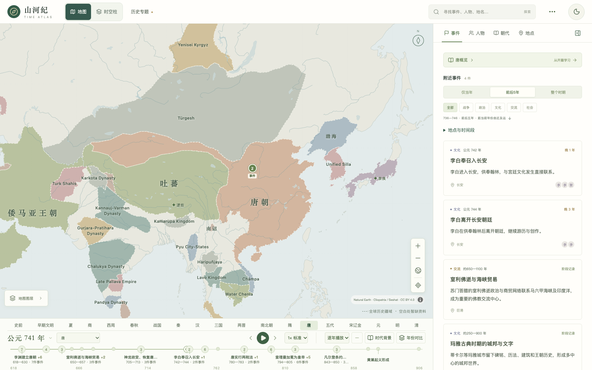

# 山河纪 · Time Atlas

**在地图上读历史，在时间中看山河。**

山河纪是一款以中国历史为主要阅读内容的交互历史地图与时空柱。沿时间轴观察政权疆域，从事件读到人物与时代背景，也可以跟随有出处的年谱、专题和地点档案探索历史。

**[在线体验](https://history.zhaoguhong.com/)** · [本地运行](#本地运行) · [数据与来源](docs/data.md) · [参与贡献](CONTRIBUTING.md)



## 可以怎样探索

- **沿时间看山河**：约公元前 10000 年至公元 1912 年，支持拖动、播放、直接跳转年份及两个年份的疆域对比。
- **从事件读到人物**：联动阅读事件经过、背景、影响、人物介绍、朝代档案和原始出处。
- **跟随专题学习**：按章节走进三国、丝绸之路、大运河、宋代社会等专题，保存阅读进度并继续学习。
- **观看有据年谱**：苏轼、康熙、诸葛亮的已核对活动记录逐段播放；动画仅表达记录先后，不推断真实道路。
- **按地点和条件发现内容**：地点档案、人物及别名搜索、事件分类、年代区间和地图范围筛选。
- **收藏、分享与返回**：收藏保存在浏览器中；分享链接保留阅读和地图状态，支持桌面及手机布局。

当前收录 **643 个事件、673 个人物、53 个中国朝代与政权档案、55 个世界政权档案、13 个专题及 97 个章节**。人物中 280 份有编辑介绍，393 份是基础身份记录，不能等同于完整传记。本轮新增 78 个有来源的世界史事件，含原有记录共 198 个中国之外的事件，时间截至 1912 年。数据截至 2026-10-23，最新统计见 [覆盖清单](public/data/coverage.json)。

## 世界历史地图

地图统一浏览中外历史。左下角的“地图图层”控制历史事件、城市与都城及政权图层的显示。时空柱的“中国历史／世界历史／中外对照”和世界地区选择只影响时空柱；切回地图会显示完整的中外事件范围，再返回时空柱仍保留原选择。地图与时空柱共享年份和选中事件，支持刷新、分享与返回。

主要世界政权有中文地图标签、简明历史档案、年代说明与参考来源，也可从搜索和政权目录打开。世界政权与中国朝代档案分别维护。新旧事件共同用于地图标记、时间轴、时空柱与阅读，不依靠现代国界推断历史归属。当前覆盖见 `public/data/coverage.json`；这是重要节点选编，未收录或缺少合适轮廓的地区保持空白，不补画未经来源支持的边界。

## 时空柱模式

顶栏提供“地图／时空柱”文字切换，手机采用带图标的轻量胶囊切换；画布内只在隐藏顶栏的专注模式提供模式切换。右上角太阳／月亮按钮控制全站白天与夜间模式，覆盖地图、阅读、搜索和弹窗；首次跟随系统，手动选择后会记住。时空柱画布右下角的浅色齿轮按钮打开设置，可切换中外对照、仅世界历史、仅中国历史，并选择样式。设置悬浮在内容上，时空柱延伸到底部；宽屏缩放放进现有底栏，窄屏缩放位于画布左下角，拖动时悬浮工具暂时隐藏。“查看历史全貌”收进设置，展开全部年代，不是全屏按钮。对照模式左侧为中国之外的历史，右侧为中国历史；世界史可进一步筛选欧洲、西亚、中亚、南亚、东亚其他地区、东南亚、非洲、美洲和大洋洲。

上下拖动或滚轮移动年代，双指捏合或 Ctrl / ⌘ 加滚轮缩放。平移时事件与连线一起移动，边缘补入新的事件，松手保持当前位置；放大到很小的时间范围也能细致拖动。“＋ / −”与全貌按钮提供替代操作；画布获得键盘焦点后可用上下方向键、加减键和 Home / End。筛选面板支持年份定位、时期、类别、播放速度、连续年份或逐事件年份播放以及时间区间。

画布提供四种样式：默认的通透“琉璃时柱”、细线“素笺编年”、卷轴“山河长卷”和几何“经纬织带”。每种样式都支持白天和夜间，并有独立的渐层、远景与材质，样式与昼夜模式分别记住，切换不会改变年代、筛选和阅读内容。默认仅显示日期／时间区间与事件名；手机将日期与事件名分成两行，长标题在末尾省略，完整标题、日期说明与简介可点击阅读。简介也可在设置中开启。刻度使用“1050年”“公元前221年”等中文纪年。事件根据可用空间、重要程度和年代分布排列，时间范围缩小时展开更局部的内容。底部“全部事件”列出当前范围与筛选下的所有事件，包括画布未展开的内容，可搜索、阅读或放大对应区间。点击事件可阅读背景、经过、影响和来源，并沿明确标注的前后发展、主题或同年代线索继续阅读；同年代不代表因果关系。地图与时空柱共享选中事件，链接保留模式、范围、筛选与缩放。进入画布时背景渐次显现；按钮缩放和年份定位平滑过渡，拖动／双指／滚轮操作保持跟手。连续操作会中断并衔接当前画面，系统启用“减少动态效果”时关闭进场和过渡。

事件与分期展示至 1912 年。近似年代、长时段过程和地点参照分别注明；世界史资料仍为重要节点选编，并非穷尽所有地区和时代。新增内容由本站独立编写，参考 OpenStax 世界史及博物馆、档案馆、大学的公开资料，未复制全历史的界面、文本或图片。

## 手机横屏与全屏

开启手机自动旋转后，横屏使用左地图、右资料布局，竖屏使用底部阅读抽屉。右上角“更多操作”提供：

- **全屏浏览**：由你点击进入，支持时隐藏浏览器界面；不支持或被拒绝时提供替代方式。
- **添加到主屏幕**：支持安装的浏览器会弹出安装提示，其他浏览器显示对应步骤。从主屏幕以网页 App 打开可使用独立窗口，仍需联网加载内容。
- **进入专注模式**：收起网站顶部导航，保留地图、阅读和时间轴。点击左上角按钮恢复导航；键盘也可按 Escape 退出。

全屏和专注模式可以配合使用。旋转或切换显示方式会保留当前年份与阅读内容；浏览器地址栏是否隐藏取决于浏览器能力和打开方式。

## 本地运行

需要 **Node.js 22.12+**，推荐 Node.js 24；仓库提供 `.nvmrc`。日常开发无需 Python、业务后端、数据库、地图 API Key 或在线瓦片服务。

下载仓库后，在项目目录运行：

```sh
npm ci
npm run dev
```

打开终端显示的地址，默认是 `http://127.0.0.1:5173`。地图以无损 Brotli 包随仓库提供；开发、测试和构建命令会用 Node.js 自动校验并还原，无需额外下载、Python 或重建史料缓存。浏览器仍按需读取普通 GeoJSON 切片，不在前端解压整包。人物数据也随仓库提供。

生产构建与本地预览：

```sh
npm run build
npm run preview
```

`dist/` 是完整的静态网站，可交给你选择的静态托管服务。请通过 HTTP/HTTPS 访问，不能直接双击 HTML 文件。放在子目录（例如 `/time-atlas/`）时，构建命令为：

```sh
npm run build -- --base=/time-atlas/
```

应用通过 URL hash 保存阅读状态，无需服务端路由重写。使用自己的域名时，可调整 `index.html` 中的站点 URL 元数据。

技术栈：React · TypeScript · Vite · MapLibre GL JS。

## 数据来源与边界

| 内容             | 来源与使用方式                                                 |
| ---------------- | -------------------------------------------------------------- |
| 历史疆域         | Cliopatria / Seshat，固定源版本并简化几何，保留 CC BY 4.0 署名 |
| 现代自然地理参照 | Natural Earth，公有领域数据                                    |
| 人物基础身份     | Wikidata，CC0，保留实体版本与引用                              |
| 历史讲解与年谱   | 项目整理的中文摘要，逐条提供原典、博物馆及研究机构等出处       |

地图提供来源支持的全球历史疆域轮廓，事件与人物阅读仍以中国及周边为主。**这是持续完善的历史学习项目，资料并不完整，也不代表全部史实已获专家认证。**

- 历史上没有公元 0 年；早期遗址使用约略年代和考古区间。
- 导航时期是学习分段，不等同于政权实际存续日期。
- 缺失疆域保持空白，不以相邻年份猜测填补；空白不表示当地无人居住。
- 现代海岸与河流仅作参照；事件坐标可能代表一个区域。
- 人物与事件相关，不代表本人到访；只有独立核对的活动记录进入年谱。

详见 [数据处理与维护](docs/data.md) 和 [第三方署名及许可](THIRD_PARTY_NOTICES.md)。

## 检查与贡献

```sh
npm test
npm run data:check
npm run data:audit:ci
npm run format:check
npm run build
```

`data:audit:ci` 不要求本地原始网页缓存；缺失缓存会明确报告为未核验，不会改写审校报告。维护者的完整缓存审校使用 `npm run data:audit`。

```sh
npx playwright install chromium
npm run test:e2e:smoke
```

上面的冒烟测试使用生产预览，检查桌面/手机地图和阅读。完整交互回归使用 `npm run test:e2e`；时空柱的 Chrome / WebKit 检查使用 `npm run test:e2e:pillar`；世界历史的地图／时空柱共享浏览检查使用 `npm run test:e2e:world`。GitHub Actions 配置执行格式、单元测试、数据与构建检查，以及生产冒烟、时空柱和世界历史的 Chrome 测试。

欢迎报告程序问题、补充可靠来源、纠正史实或改善交互。提交方法和证据要求见 [贡献指南](CONTRIBUTING.md)。维护约定与项目交接统一记录在 [AGENTS.md](AGENTS.md)。

接下来重点完善人物传记、文化与社会史事件、可核对年谱，以及加载性能和真实移动设备体验。

## 许可

- **项目代码、脚本及开发文档**：[MIT License](LICENSE)。
- **项目拥有权利的原创历史讲解与专题文案**：[CC BY 4.0](LICENSES/CC-BY-4.0.txt)，允许商用，分享时须署名、提供许可链接并注明修改。
- **第三方地图、结构化数据及依赖**：保留各自原许可，见 [第三方声明](THIRD_PARTY_NOTICES.md)。

详细范围与原创讲解署名示例见 [许可说明](LICENSE-CONTENT.md)。
